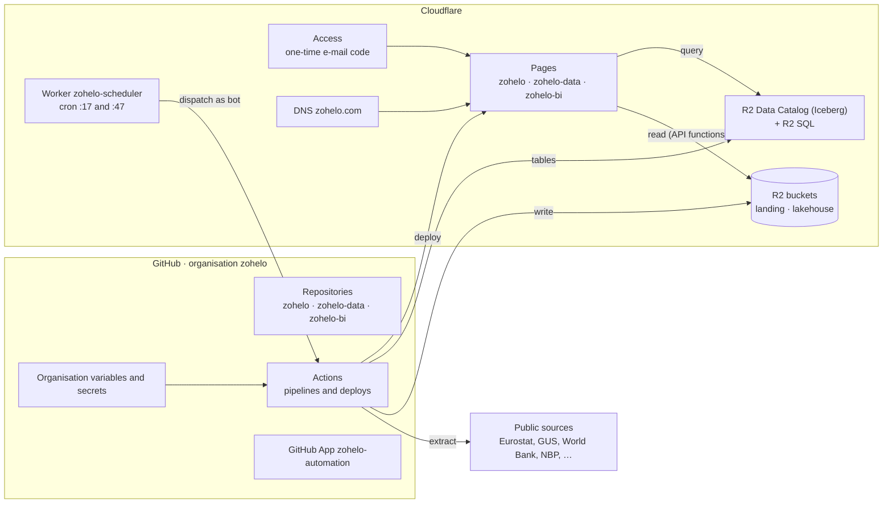

# Architecture

zohelo runs on two platforms with clear jobs:

- **GitHub** (organisation `zohelo`) holds the code, runs every pipeline and deploy (Actions),
  keeps the backlog, and is the single store of credentials (organisation variables and secrets).
- **Cloudflare** runs, stores and serves everything: R2 object storage, the R2 Data Catalog
  (Apache Iceberg) and R2 SQL, Workers, Pages, DNS and the domain registration, and Access for sign-in.

No other provider is in the stack (Google and GitHub Pages were removed on 27 October 2026).

## Products

| Product | Address | Repository | What it is | Who can open it |
|---|---|---|---|---|
| zohelo.com | zohelo.com, www.zohelo.com | [zohelo/zohelo](https://github.com/zohelo/zohelo) | The brand's public website | everyone |
| zohelo-data | data.zohelo.com | [zohelo/zohelo-data](https://github.com/zohelo/zohelo-data) | The public-data platform: ingestion, lakehouse (Landing → Bronze → Silver → Gold), and an internal portal (file explorer + SQL workspace) | allowed emails |
| zohelo-bi | bi.zohelo.com | [zohelo/zohelo-bi](https://github.com/zohelo/zohelo-bi) | Dashboards, data explorer and measure catalogue on top of the Gold layer | allowed emails |

New products follow the same pattern: repository `zohelo/zohelo-<name>`, address `<name>.zohelo.com`.

## How they fit together

- **Data flow.** The scheduler Worker starts the zohelo-data Pipeline twice an hour. The Pipeline
  extracts from public sources into the Landing bucket, loads Bronze tables in the catalog, and
  builds Silver and Gold with dbt (DuckDB engine). Only zohelo-data writes data.
- **Serving.** Each site is a Pages project. Its server-side parts are Pages Functions on the
  same origin: the data portal's file API (R2 bindings), the BI query API (R2 SQL, read-only
  token). zohelo.com is static. The browser never receives a storage credential.
- **Sign-in.** Cloudflare Access sits in front of data and bi (and every preview address of
  them); the APIs additionally verify the Access token.

## Principles

- **Capabilities, not providers, in names.** Credentials are named for what they do
  (`STORAGE_…`, `PLATFORM_…`, `SOURCE_…`), so changing a provider means new values, not a rename.
- **Infrastructure as code.** Each deploy runs an idempotent setup script that creates or corrects
  its Cloudflare project, sign-in and DNS (see [infrastructure.md](infrastructure.md)).
- **One writer, many readers.** Write credentials exist only for zohelo-data; readers get read-only twins.
- **No personal accounts in automation.** Automation acts as the organisation's GitHub App and
  organisation-owned Cloudflare tokens.

Last verified: 2026-10-28
